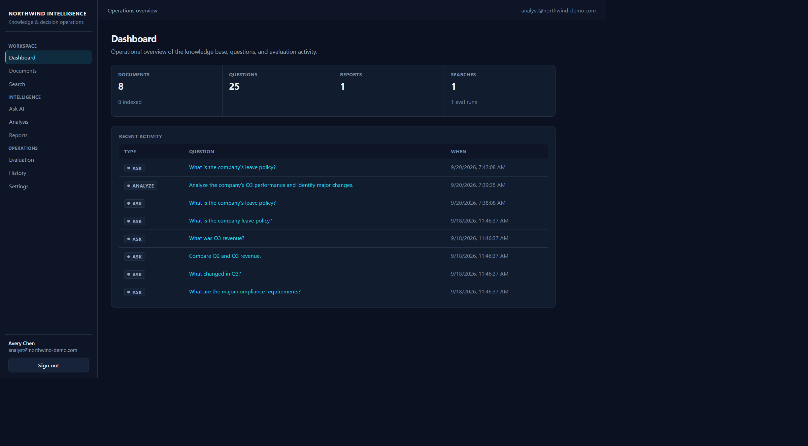
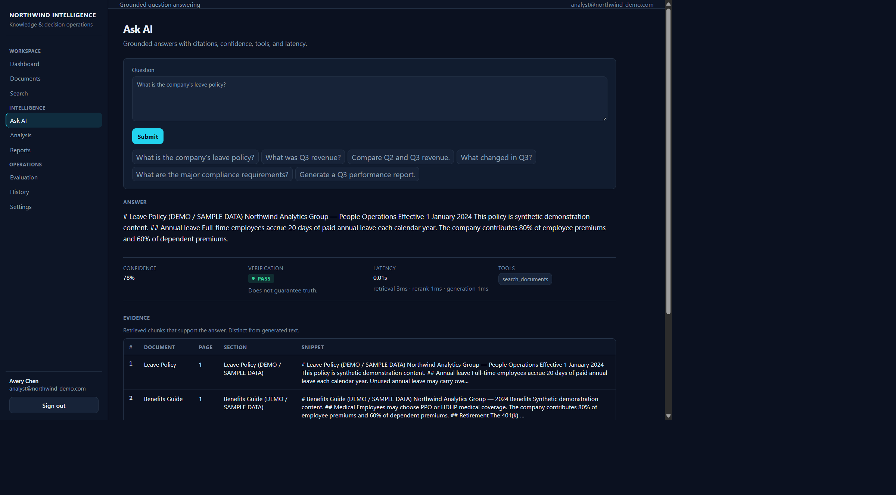
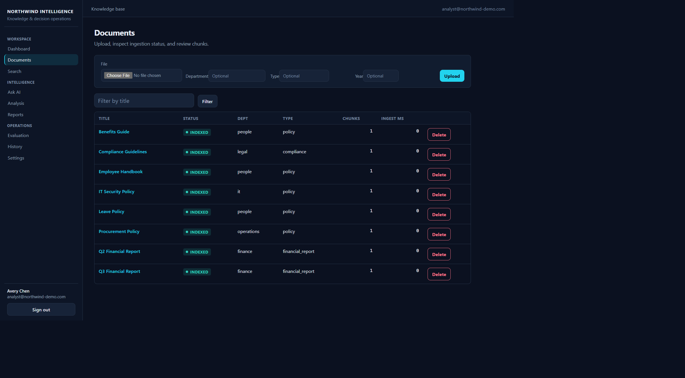
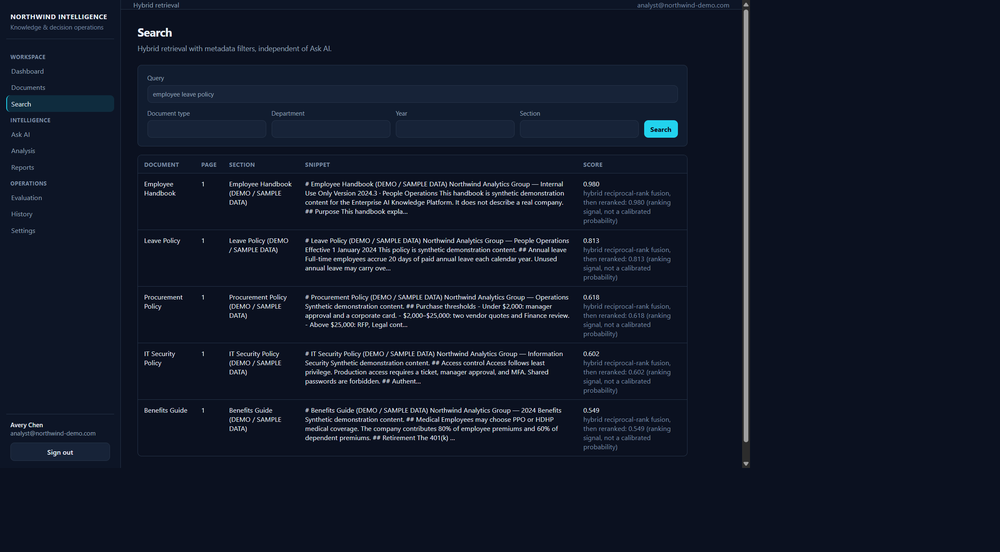
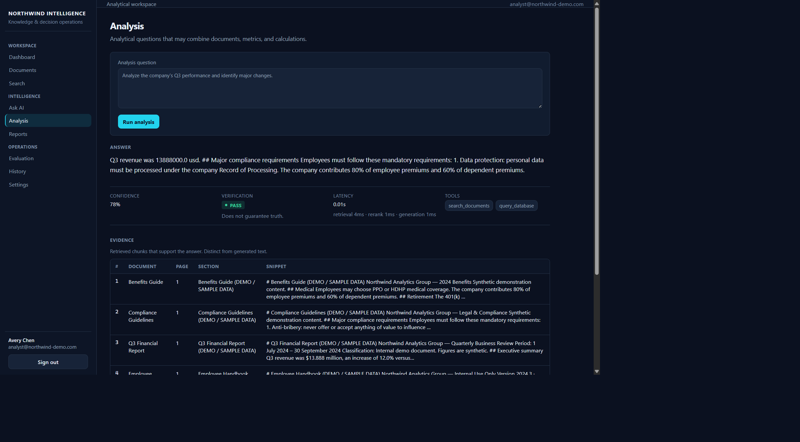
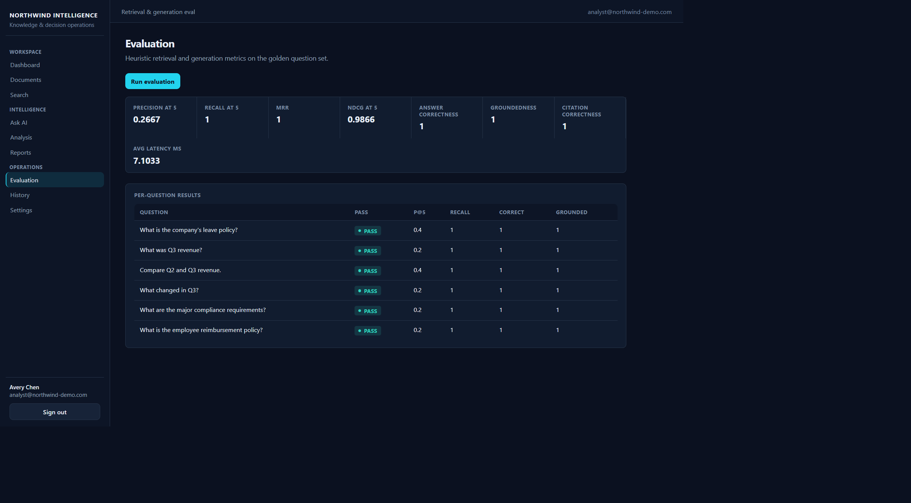
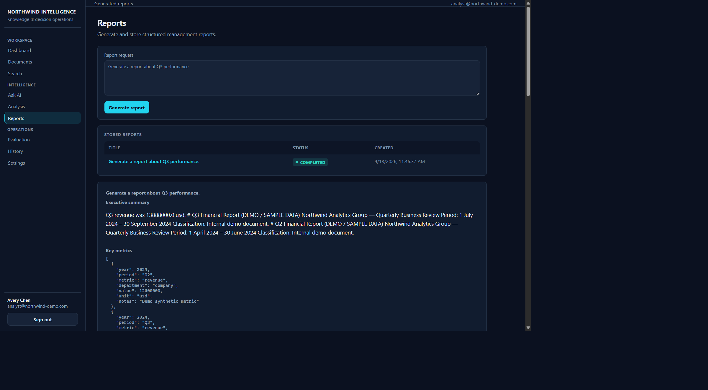
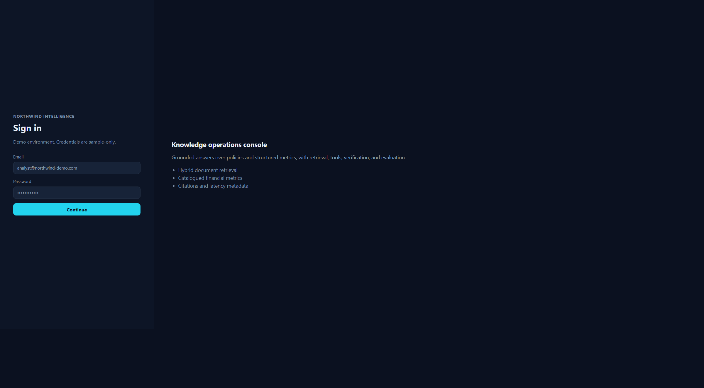
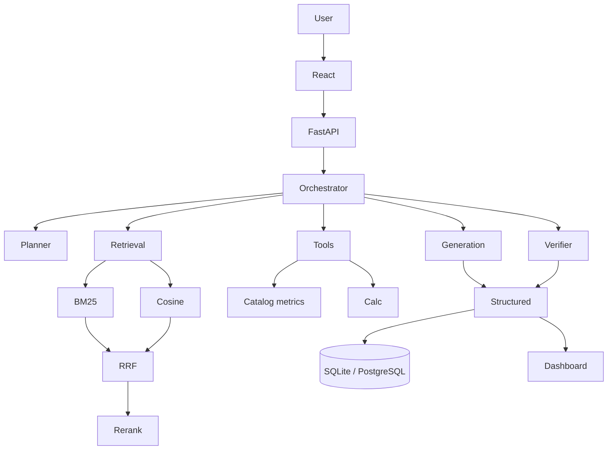

# Enterprise AI Knowledge & Decision Intelligence Platform

Enterprise-style **demo / portfolio** system for grounded question answering over documents and structured business data. It is a working application, not a notebook tutorial, and not a production SaaS.

The platform combines RAG, hybrid retrieval, tool calling, planner/orchestration, structured outputs, evidence, citations, verification, and evaluation.

It can answer from:

- enterprise documents (policies, reports)
- structured metrics (revenue, expenses, headcount, and related KPIs)

and return:

- grounded answers
- citations and evidence
- comparisons and calculations
- persisted reports
- evaluation scores

Default AI providers are **deterministic mocks** so the project runs without paid API keys.

**UI:** Northwind Intelligence is a premium dark operations console (navy/graphite surfaces, cyan primary actions, teal status). The screenshots below are from the running demo, not mockups.

## Interface

### Dashboard

Operational overview of the knowledge base, questions, and evaluation activity.



### Ask AI

Grounded answers with citations, confidence, tools, latency, and retrieved evidence.



### Documents

Ingestion, indexed status, and document management.



### Search

Hybrid retrieval with metadata filters, independent of Ask AI.



### Analysis

Analytical questions that combine documents, catalogued metrics, and calculations.



### Evaluation

Heuristic retrieval and generation metrics on the golden question set.



### Reports

Structured management reports with stored history.



### Login

Demo JWT sign-in for the operations console.



## Architecture



React talks to FastAPI. The orchestrator plans tools, retrieves evidence, generates a Pydantic-validated answer, verifies claims against evidence, and stores the interaction.

## Key features

**Ingestion:** PDF, DOCX, TXT, Markdown — validate, extract, clean, chunk with overlap, attach metadata, embed, persist.

**Retrieval:** BM25 keyword search, cosine semantic search, Reciprocal Rank Fusion, metadata filters, lexical rerank.

**Generation:** RAG from `prompts/`, structured JSON (answer, confidence, claims, sources, uncertainty, tools, latency), citations, heuristic verification.

**Tools:** `search_documents`, `query_database` (named metrics only — no arbitrary SQL), `calculate_metric`, `compare_documents`, report generation.

**Evaluation:** Precision@K, Recall@K, MRR, NDCG@K, answer correctness, relevance, groundedness, citation correctness, unsupported-claim rate.

**Product UI:** Dashboard, Ask AI, Documents, Search, Analysis, Reports, Evaluation, History, Settings, and Login — shared dark design tokens for surfaces, forms, tables, badges, and empty/error/loading states.

## Tech stack

| Layer | Stack |
| --- | --- |
| Frontend | React, TypeScript, Vite |
| Backend | Python, FastAPI, SQLAlchemy, Pydantic |
| Database | SQLite (local/tests), PostgreSQL (Compose) |
| Retrieval | BM25, hashed embeddings + cosine, RRF, rerank |
| AI | Provider interfaces; mock default; optional OpenAI |
| Tests | Pytest |
| Infra | Docker Compose, GitHub Actions |

## How it works

**Ingestion:** document → validation → extraction → cleaning → chunking → metadata → embeddings → storage.

**Ask:** question → planner → hybrid retrieval → rerank → context → generation → structured output → verification → citations.

**Metrics:** question → planner → catalog database tool → optional calculation → structured response.

**Report:** question → plan/retrieve/tools → analysis → verification → sectioned report → database.

## Retrieval strategy

1. **BM25-style keyword search** over chunk text.
2. **Semantic search** via cosine similarity on stored vectors.
3. **Reciprocal Rank Fusion** merges the two ranked lists (ranks, not raw BM25 mixed with cosine).
4. **Metadata filters** (document type, department, year, section) when provided.
5. **Rerank** using query-token overlap and title match after min-max normalizing fused scores.

UI scores are ranking signals, not calibrated probabilities.

**Demo embeddings** are hashed bag-of-words. They demonstrate the pipeline locally. Set `EMBEDDING_PROVIDER=openai` and `LLM_API_KEY` to use a hosted embedding model.

## Evaluation

Measured on the six-question golden set (`evaluation/dataset/golden_set.json`) in mock mode:

| Metric | Result |
| ---: | ---: |
| Recall@5 | 1.0000 |
| MRR | 1.0000 |
| NDCG@5 | 0.9866 |
| Precision@5 | 0.2667 |
| Answer correctness | 1.0000 |
| Groundedness | 1.0000 |
| Citation correctness | 1.0000 |
| Unsupported claim rate | 0.0000 |

Precision@5 is lower because extra documents still appear in the top five. Recall@5 of 1.0 means the expected evidence was retrieved. This is an engineering result, not a failure to hide.

## Demo questions

1. What is the company's leave policy?
2. What was Q3 revenue?
3. Compare Q2 and Q3 revenue.
4. What changed in Q3?
5. What are the major compliance requirements?
6. Generate a Q3 performance report.

Seed data is synthetic **Northwind Analytics Group** content, labeled as demo.

## Local setup

Use **CPython 3.11+** (not MSYS/MinGW Python).

```powershell
cd backend
python -m venv .venv
.\.venv\Scripts\python.exe -m pip install -r requirements.txt
copy ..\.env.example ..\.env
.\.venv\Scripts\python.exe -m uvicorn app.main:app --reload --host 127.0.0.1 --port 8000
```

For a zero-infra demo, set in `.env`:

```
DATABASE_URL=sqlite:///./platform.db
LLM_PROVIDER=mock
EMBEDDING_PROVIDER=mock
```

```powershell
cd frontend
npm install
npm run dev
```

Open http://localhost:5173. The Vite dev server proxies `/api` to port 8000.

### Demo credentials

These are **demo-only** credentials created by seed, not production accounts:

- Email: `analyst@northwind-demo.com`
- Password: `DemoPass123!`

## Environment variables

See `.env.example`. Do not commit `.env`.

| Variable | Purpose |
| --- | --- |
| `DATABASE_URL` | SQLAlchemy URL (SQLite or PostgreSQL) |
| `LLM_PROVIDER` | `mock` (default) or `openai` |
| `LLM_API_KEY` | Optional hosted API key |
| `LLM_MODEL` | Chat model name when using OpenAI |
| `EMBEDDING_PROVIDER` | `mock` (default) or `openai` |
| `EMBEDDING_MODEL` | Embedding model name when using OpenAI |
| `SECRET_KEY` | JWT signing secret |

## Docker

```powershell
docker compose config
docker compose up --build
```

- API: http://localhost:8000/api/health
- UI: http://localhost:5173 (`/api` proxied by nginx)

**Docker runtime was not verified** in the development environment because the Docker engine was unavailable. Compose configuration (`docker compose config`) is valid.

## Testing

```powershell
cd backend
.\.venv\Scripts\python.exe -m pytest -q
```

Verified locally: **36 backend tests passed**.

```powershell
cd frontend
npm run build
```

Frontend production build succeeds. TypeScript `tsc --noEmit` succeeds.

## CI

`.github/workflows/ci.yml` installs backend dependencies, runs pytest with mock providers, installs frontend dependencies, and builds the UI.

Repository: [karthik2104-cr/Enterprise-AI-Knowledge-Decision-Intelligence-Platform](https://github.com/karthik2104-cr/Enterprise-AI-Knowledge-Decision-Intelligence-Platform)

## Project structure

```
backend/           FastAPI app, retrieval, RAG, tools, tests
frontend/          React workspace (dark operations UI)
prompts/           Planner, RAG, verifier, report, extraction templates
sample_data/       Demo documents used for seed
evaluation/        Golden set and eval scripts
docs/              Architecture notes
docs/screenshots/  Live UI captures used in this README
.github/           GitHub Actions
```

## Limitations

These are intentional scope choices, not unfinished features:

- Default `LLM_PROVIDER=mock` extracts metric facts and evidence sentences; it is not a general LLM.
- Default embeddings are hashed bag-of-words, not a trained semantic model.
- Vectors are JSON on `document_chunks`, not pgvector.
- Authentication is a single seeded JWT user.
- Docker images were not runtime-tested here.
- Retrieval can include extra weak candidates (see Precision@5).

## Future improvements

Optional, not required for this demo:

- pgvector or a dedicated vector index
- hosted LLM/embedding providers in default setup
- multi-user SSO
- stronger retrieval/rerank models
- a larger evaluation set
