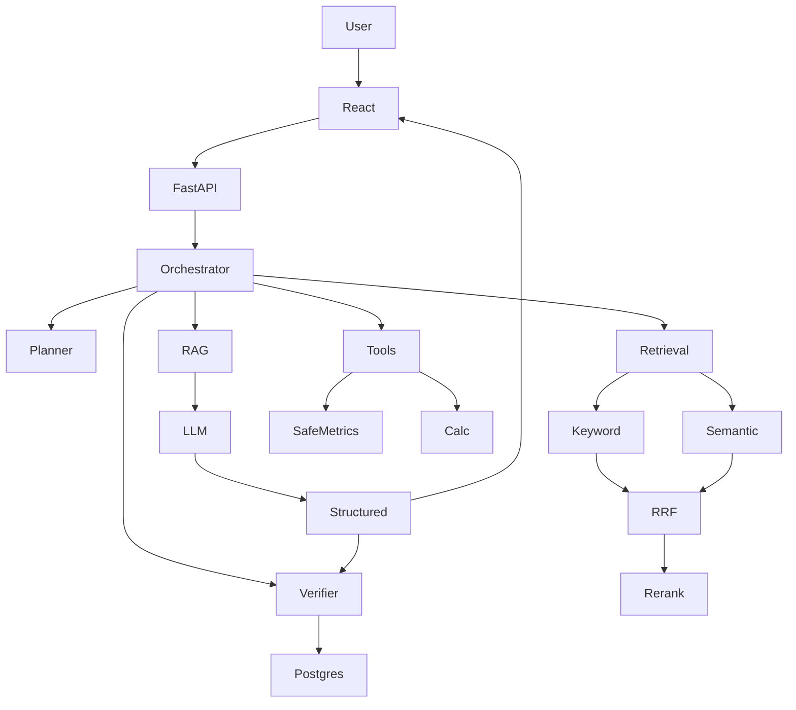

# Architecture

The backend is a modular FastAPI application. `LLMProvider` and `EmbeddingProvider` isolate model implementations. PostgreSQL (Compose) or SQLite (local/tests) stores documents, chunks, JSON vectors, queries, responses, sources, reports, and evaluation results.

**Mock mode** is the default so tests and demos run without API keys. It is not equivalent to a hosted LLM.
