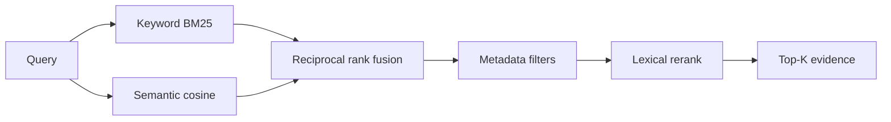

# Retrieval pipeline

1. Tokenize the query.
2. Keyword search: BM25-style scoring over indexed chunks.
3. Semantic search: cosine similarity against stored vectors (hashed bag-of-words in mock mode, or the configured embedding API).
4. Merge with **reciprocal rank fusion** so BM25 magnitudes are not mixed with cosine scores.
5. Metadata filters: document type, department, year, section (applied when loading candidates).
6. Rerank using query-token overlap, title match, and a short-chunk penalty.
7. Return top-k evidence with document, page, section, snippet, method, and an explained ranking score.

Scores in the UI are ranking signals, not calibrated probabilities.
